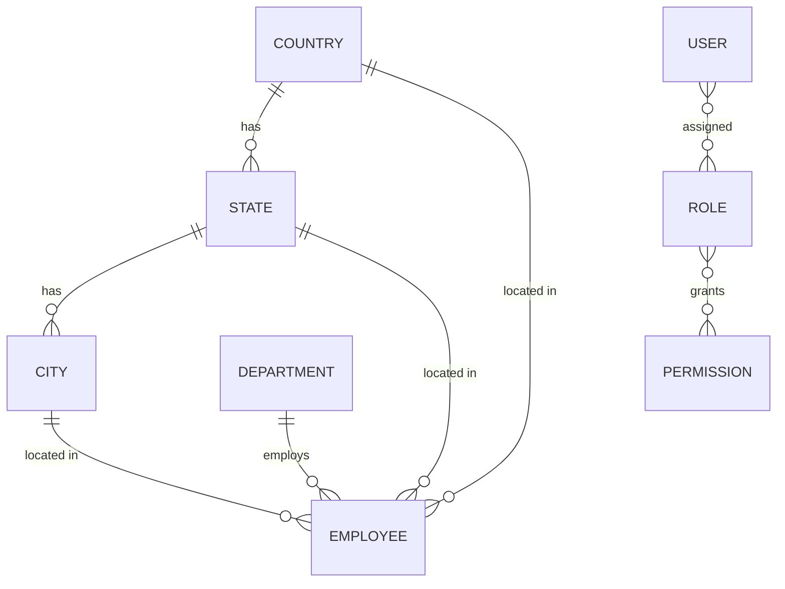

<div align="center">


</div>

An app that lets an organisation keep and maintain its employee records. An admin area provides searchable, sortable tables and forms for employees, their departments and locations, and for managing users, roles and permissions.

## ✨ Features

- 👥 **Employee records**: name, department, country / state / city, zip code, birth date and hire date
- 🏢 **Departments** and 🌍 **Countries → States → Cities** managed as separate resources
- 🔐 **Role-based access** with `spatie/laravel-permission`: the whole `/admin` area requires the `admin` role
- 🧑‍💼 **User, role and permission management** screens
- 📊 **Splade tables** (sorting, searching, pagination, bulk actions and exports) built on `spatie/laravel-query-builder`
- 🪪 Authentication and profile management from Laravel Breeze (Splade flavour)
- 🧪 Dusk browser testing and PHPUnit configured

## 🏗️ Architecture



## 🧰 Tech stack

| Layer | Technology |
| --- | --- |
| Backend | PHP, Laravel 10, Sanctum |
| Authorization | spatie/laravel-permission |
| UI | Splade (Blade + Vue 3), Tailwind CSS 3, Vite |
| Data tables | Splade tables, spatie/laravel-query-builder |
| Database | MySQL (default DB name `employees_app`) |
| Testing | PHPUnit, Laravel Dusk, Pint |

## 🚀 Getting started

```bash
git clone https://github.com/Brian-Dol/Employee-management-system-Laravel.git
cd Employee-management-system-Laravel

composer install
npm install

cp .env.example .env
php artisan key:generate
# create the database and set DB_* values in .env, then:
php artisan migrate --seed

npm run dev          # in one terminal
php artisan serve    # in another
```

The seeder creates 100 sample users, an `admin` role and an admin account (`admin@example.com`); see `database/seeders/DatabaseSeeder.php` for its password and change it for any real deployment. Sign in and open `/admin`.

## 📁 Project structure

```text
app/Http/Controllers/   Resource controllers (employees, departments, locations, users, roles...)
app/Tables/             Splade table definitions
app/Forms/              Splade form classes
app/Models/             Employee, Department, Country, State, City, User
resources/views/admin/  Admin pages per resource
```

## 🗺️ Notes

- Seeds only create users and the admin role; countries, states, cities and departments must be added through the admin UI.
- The non-admin dashboard is the stock Breeze page; all management features live under `/admin`.

## 👤 Author

**Brian Dol**, Senior Full Stack Engineer · [Portfolio](https://portfolio.dol-brian23.workers.dev/) · [LinkedIn](https://linkedin.com/in/brian-dol-31a06115a/)
